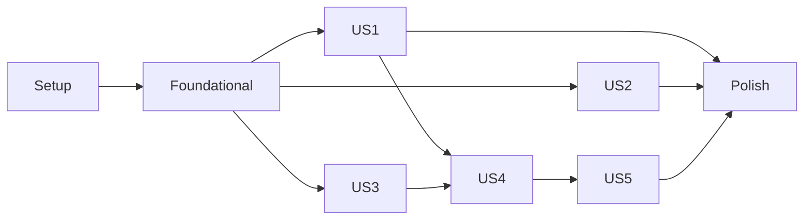

---

description: "Task list for Sala do Eco (versão console)"
---

# Tasks: Sala do Eco (versão console)

**Input**: Design documents from `/specs/001-sala-do-eco-console/`

**Prerequisites**: [plan.md](plan.md), [spec.md](spec.md), [research.md](research.md), [data-model.md](data-model.md), [contracts/](contracts/), [quickstart.md](quickstart.md)

**Tests**: OBRIGATÓRIOS. A constituição (Princípio III, Test-First NON-NEGOTIABLE) exige testes escritos e vistos falhando antes da implementação.

**Organization**: tarefas agrupadas por história de usuário, para que cada uma seja implementada e testada de forma independente.

## Format: `[ID] [P?] [Story] Description`

- **[P]**: pode rodar em paralelo (arquivos diferentes, sem dependências pendentes)
- **[Story]**: história de usuário à qual a tarefa pertence (US1 a US5)

## Path Conventions

Projeto único na raiz: `index.js`, `src/`, `tests/` (ver [plan.md](plan.md)).

---

## Phase 1: Setup (Shared Infrastructure)

**Purpose**: inicialização do projeto

- [X] T001 Criar `package.json` na raiz com `"type": "module"`, `"engines": { "node": ">=22" }`, scripts `"test": "node --test tests/"`, `"lint": "eslint ."` e `"start": "node index.js"`, sem dependências de produção, em package.json
- [X] T002 Criar a estrutura de pastas do plano (`src/core/patterns`, `src/storage`, `src/logging`, `src/cli`, `tests/acceptance`, `tests/unit`, `tests/integration`) com um `index.js` mínimo na raiz que importa e chama `main()` de `src/cli/app.js`, em index.js
- [X] T003 [P] Instalar ESLint como dependência de desenvolvimento e configurar regras recomendadas, proibindo `no-eval`, `no-implied-eval` e `no-new-func`, em eslint.config.js
- [X] T004 [P] Criar `.gitignore` ignorando `node_modules/`, `dados/` e arquivos `*.log`, em .gitignore

---

## Phase 2: Foundational (Blocking Prerequisites)

**Purpose**: base compartilhada que precisa existir antes de qualquer história

**⚠️ CRITICAL**: nenhuma história pode começar antes desta fase terminar

- [X] T005 [P] Escrever testes de `exact-number`: converter tokens `"3"`, `"-3"`, `"1.5"`, `"1,5"` para inteiros `BigInt` escalados por `10^casas` com escala comum à sequência; formatar fração reduzida como decimal exato (`15`, `6`, `-0.5`, `4.5`) ou como fração quando a expansão é infinita (`10/3`); números com 30 dígitos sem perda de precisão, em tests/unit/exact-number.test.js
- [X] T006 Implementar `exact-number` (escala comum, operações de soma, subtração, multiplicação e divisão exatas com fração `{num, den}` em `BigInt`, redução por MDC e formatação) até os testes de T005 passarem, em src/core/exact-number.js
- [X] T007 [P] Escrever testes do analisador básico: `"3, 6, 9, 12"` e `"3 6 9 12"` resultam em 4 números; tokens precisam casar com `^[+-]?\d+([.,]\d+)?$`; o analisador nunca usa `eval`, `Function` nem `Number()` para validar, em tests/unit/parse-input.test.js
- [X] T008 Implementar o analisador básico (separadores vírgula e/ou espaços, decimais com ponto) retornando `{ ok: true, sequencia: { valores, casas, quantidade } }` ou `{ ok: false, erro, detalhe }`, em src/core/parse-input.js
- [X] T009 [P] Criar o catálogo de mensagens em português do Brasil, exportando funções por código (`boasVindas`, `ajuda`, `pedirNome`, `resposta`, `semPadrao`, `ENTRADA_VAZIA`, `NUMERO_INVALIDO`, `QUANTIDADE_INSUFICIENTE`, `ENTRADA_MUITO_GRANDE`, `comandoDesconhecido`, `despedida`) com os textos de exemplo de contracts/cli-commands.md, em src/cli/messages.pt-br.js
- [X] T010 [P] Escrever testes do logger: grava JSON Lines com campos fixos `ts`, `nivel` (`info`, `aviso`, `erro`) e `evento` e opcionais `codigo` e `status`; recusa campos não permitidos (nunca grava sequências, apelidos ou PINs); rotaciona para `eco.log.1` ao passar de 1 MiB, em tests/unit/logger.test.js
- [X] T011 Implementar o logger com pasta vinda de `ECO_DATA_DIR` (padrão `./dados`), criando a pasta se necessário, em src/logging/logger.js
- [X] T012 Implementar o esqueleto do laço interativo com `node:readline`: exibir boas-vindas e ajuda, pedir nome ou apelido ("1 a 40 caracteres", sem caracteres de controle; repetir a pergunta se inválido), ler linhas, encerrar no fim da entrada e em `Ctrl+C` com código 0, falha fatal com mensagem em português e código 1, sem exibir rastros de pilha, em src/cli/app.js

**Checkpoint**: base pronta; as histórias podem começar

---

## Phase 3: User Story 1 - Aluno recebe o próximo número da sequência (Priority: P1) 🎯 MVP

**Goal**: o aluno informa uma sequência e recebe o próximo número com o padrão identificado, ou o aviso de que não há padrão.

**Independent Test**: rodar `npm test -- tests/acceptance` e os cenários 1 a 5 e 10 do [quickstart.md](quickstart.md).

### Tests for User Story 1 ⚠️

> Escrever primeiro e confirmar que falham

- [X] T013 [P] [US1] Escrever testes de aceitação com os exemplos oficiais da seção 8 de requisitos.md: `3, 6, 9, 12` → `15`; `1, 4, 9, 16` → `25`; `2, 4, 8` → `16`; `2, 4` → `6`; `1, 1, 2, 3, 5` → `8`, em tests/acceptance/exemplos-professores.test.js
- [X] T014 [P] [US1] Escrever testes unitários dos padrões, cada um no seu `describe`: constante (`7, 7, 7` → `7`, mínimo 2); aritmética (`-3, 0, 3` → `6`, decimais `0.1, 0.2, 0.3` → `0.4` exato, mínimo 2); geométrica (`3, -6, 12` → `-24`, `8, 4, 2` → `1`, rejeita termo zero, mínimo 3); Fibonacci (mínimo 4, `1, 1, 2` não é Fibonacci); polinomial (grau `k` de 2 a 5, mínimo `k + 2` números, `1, 8, 27, 64, 125` → `216`), em tests/unit/patterns.test.js
- [X] T015 [P] [US1] Escrever testes de `predict`: precedência fixa constante → aritmética → geométrica → Fibonacci → polinomial (`2, 4, 8` → geométrica `16`); `3, 1, 4, 1, 5` → `status: "sem_padrao"` sem `proximo`; mesma entrada gera sempre o mesmo resultado; 1.000.000 de números aritméticos respondem em menos de 5 s e 1.000 números em menos de 1 s, em tests/unit/predict.test.js

### Implementation for User Story 1

- [X] T016 [P] [US1] Implementar o padrão constante, em src/core/patterns/constant.js
- [X] T017 [P] [US1] Implementar o padrão aritmético (diferença constante, uma passada O(n)), em src/core/patterns/arithmetic.js
- [X] T018 [P] [US1] Implementar o padrão geométrico (razão como fração exata `a1/a0`, termos não nulos, mínimo 3 números), em src/core/patterns/geometric.js
- [X] T019 [P] [US1] Implementar o padrão Fibonacci (`a[i] = a[i-1] + a[i-2]`, mínimo 4 números), em src/core/patterns/fibonacci.js
- [X] T020 [P] [US1] Implementar o padrão polinomial por diferenças finitas (menor grau `k` de 2 a 5 com `k`-ésima diferença constante, mínimo `k + 2` números, próximo por soma das diferenças, retornando `grau`), em src/core/patterns/polynomial.js
- [X] T021 [US1] Implementar `predict(sequencia)` aplicando os padrões na ordem de precedência e retornando `{ status: "ok" | "sem_padrao", padrao, grau?, proximo }` com `proximo` formatado por exact-number, sem nenhuma importação de `src/cli`, `src/storage` ou `src/logging`, em src/core/predict.js
- [X] T022 [US1] Ligar `predict` ao laço do console: para cada linha que não começa com `/`, analisar, prever e exibir `O eco responde: <proximo>` mais a linha `Padrão: <nome>` ou a mensagem de sem padrão; registrar no log o evento `eco_registrado` com `status`, em src/cli/app.js

**Checkpoint**: US1 funcional; o MVP pode ser demonstrado

---

## Phase 4: User Story 2 - Aluno digita do jeito que preferir e recebe avisos claros (Priority: P1)

**Goal**: aceitar `;` com vírgula decimal e rejeitar entradas inválidas com mensagens claras em português, sem encerrar o programa.

**Independent Test**: cenários 6 a 9 do [quickstart.md](quickstart.md) e `npm test -- tests/unit/parse-input.test.js`.

### Tests for User Story 2 ⚠️

- [X] T023 [P] [US2] Ampliar os testes do analisador: `1,5; 3; 4,5` → valores 1,5, 3 e 4,5 (com `;`, ele é o único separador e vírgula ou ponto são decimais); espaços extras e separadores repetidos são tolerados; `10, 20, 30, abc` → `NUMERO_INVALIDO` com `detalhe: { token: "abc", posicao: 4 }`; `5` → `QUANTIDADE_INSUFICIENTE`; vazio ou só separadores → `ENTRADA_VAZIA`; mais de 16 MiB → `ENTRADA_MUITO_GRANDE`; `1e3`, `NaN`, `Infinity`, `1; DROP` são rejeitados, em tests/unit/parse-input.test.js
- [X] T024 [P] [US2] Adicionar `1,5; 3; 4,5` → `6` aos testes de aceitação e escrever o teste de integração que alimenta o console por entrada redirecionada com `Ana`, `abc`, linha vazia e `3, 6, 9`, verificando as mensagens em português, a ausência de rastro de pilha e a resposta `15` no final, em tests/integration/entrada-invalida.test.js

### Implementation for User Story 2

- [X] T025 [US2] Estender o analisador com o modo `;`, a regra mínima ("Sequências com menos de 2 números MUST ser rejeitadas") e todos os códigos de erro com `detalhe`, em src/core/parse-input.js
- [X] T026 [US2] Exibir no console a mensagem do catálogo correspondente a cada código de erro, mantendo a sessão ativa e registrando no log o evento `entrada_invalida` com `codigo` (sem a entrada), em src/cli/app.js

**Checkpoint**: US1 e US2 funcionam de forma independente

---

## Phase 5: User Story 3 - Várias sequências na mesma sessão (Priority: P2)

**Goal**: o aluno informa várias sequências seguidas e encerra quando quiser.

**Independent Test**: cenário 11 do [quickstart.md](quickstart.md).

### Tests for User Story 3 ⚠️

- [X] T027 [P] [US3] Escrever o teste de integração: `Ana`, `3, 6, 9`, `2, 4, 8`, `/ajuda`, `/comando-x`, `/sair` → duas respostas independentes (`12` e `16`), texto de ajuda, mensagem de comando desconhecido, despedida e código de saída 0, em tests/integration/sessao.test.js

### Implementation for User Story 3

- [X] T028 [US3] Implementar o despachante de comandos com `/ajuda`, `/sair` e a resposta para comando desconhecido (`Não conheço esse comando. Digite /ajuda.`), deixando pontos de extensão para `/historico`, `/professor` e `/admin`, em src/cli/commands.js
- [X] T029 [US3] Integrar o despachante ao laço, encaminhando linhas iniciadas por `/` para `commands.js`, em src/cli/app.js

**Checkpoint**: sessões com várias sequências funcionam

---

## Phase 6: User Story 4 - Memórias e histórico guardados (Priority: P2)

**Goal**: cada eco é guardado de forma durável e pode ser consultado depois de reabrir o programa.

**Independent Test**: cenários 12 e 17 do [quickstart.md](quickstart.md).

### Tests for User Story 4 ⚠️

- [X] T030 [P] [US4] Escrever testes da escrita atômica: grava em arquivo temporário na mesma pasta, faz `fsync` e `rename`; copia o arquivo anterior para `.bak`; falha simulada no meio da escrita deixa o arquivo original intacto, em tests/unit/atomic-write.test.js
- [X] T031 [P] [US4] Escrever testes do `memory-store` seguindo contracts/storage-schema.md: `versaoEsquema: 1`; eco com `id` (UUID), `aluno`, `criadoEm` (ISO 8601 UTC), `entrada` ("cortada em 4.096 caracteres", com `truncado: true`), `quantidade`, `status` (`ok`, `sem_padrao` ou `invalido`), `padrao` só se `ok`, `erro` só se `invalido`; listagem do mais recente para o mais antigo; JSON corrompido → aviso, restauração do `.bak` e cópia do arquivo ruim preservada; `versaoEsquema` maior que a conhecida → recusa gravar, em tests/unit/memory-store.test.js
- [X] T032 [P] [US4] Escrever o teste de integração: sessão 1 com `Ana`, `3, 6, 9`, `abc`, `/sair`; sessão 2 com `Ana`, `/historico` na mesma `ECO_DATA_DIR` temporária → lista os dois ecos, o inválido primeiro; processo encerrado com `SIGINT` após um eco mantém o eco gravado, em tests/integration/memorias.test.js

### Implementation for User Story 4

- [X] T033 [P] [US4] Implementar `atomicWrite(caminho, conteudo)` com arquivo temporário, `fsync`, `rename` e backup `.bak`, em src/storage/atomic-write.js
- [X] T034 [US4] Implementar o `memory-store` (carregar com recuperação, `adicionar(eco)`, `listarPorAluno(nome)`, `listarTodos()`, `apagarTudo()`) usando `ECO_DATA_DIR`/`memorias.json` e `atomicWrite`, registrando no log `memorias_corrompidas` quando aplicável, em src/storage/memory-store.js
- [X] T035 [US4] Gravar cada eco (inclusive inválidos e sem padrão) antes de exibir a resposta, em src/cli/app.js
- [X] T036 [US4] Implementar `/historico`, listando os ecos do aluno atual do mais recente ao mais antigo com data e hora, entrada, resultado ou erro, em src/cli/commands.js

**Checkpoint**: memórias persistem entre sessões e resistem a interrupções

---

## Phase 7: User Story 5 - Professor vê os alunos e administrador apaga memórias (Priority: P3)

**Goal**: modo professor e modo administrador protegidos por PIN local.

**Independent Test**: cenários 13 a 16 do [quickstart.md](quickstart.md).

### Tests for User Story 5 ⚠️

- [X] T037 [P] [US5] Escrever testes do `pin-store`: PIN de 4 a 8 dígitos; hash `scrypt` com sal aleatório de 16 bytes salvo em `config.json` como `{ sal, hash }` em base64; o PIN nunca aparece em texto puro no arquivo; comparação em tempo constante; PINs de professor e administrador independentes, em tests/unit/pin-store.test.js
- [X] T038 [P] [US5] Escrever o teste de integração: ecos de `Ana` e `Bruno`; `/professor` com definição de PIN → ecos agrupados por aluno; 3 PINs errados → volta à sessão sem dados; `/admin` com resposta `nao` → nada apagado; `/admin` com `APAGAR` → histórico vazio, em tests/integration/professor-admin.test.js

### Implementation for User Story 5

- [X] T039 [P] [US5] Implementar o `pin-store` (`definirPin(perfil, pin)`, `verificarPin(perfil, pin)`, `temPin(perfil)`) com `node:crypto` `scrypt` e `timingSafeEqual`, gravando com `atomicWrite` e permissão `0o600` quando suportado, em src/storage/pin-store.js
- [X] T040 [US5] Implementar a leitura de PIN sem eco na tela, com 3 tentativas e atraso crescente entre elas, e o fluxo de primeiro uso (definir e confirmar), em src/cli/commands.js
- [X] T041 [US5] Implementar `/professor`, listando os ecos de todos os alunos agrupados por aluno, com entrada, resultado ou erro e data e hora, em src/cli/commands.js
- [X] T042 [US5] Implementar `/admin`, que apaga todas as memórias somente após a confirmação exata `APAGAR` e registra no log o evento `memorias_apagadas`, em src/cli/commands.js

**Checkpoint**: todas as histórias funcionam de forma independente

---

## Phase 8: Polish & Cross-Cutting Concerns

- [X] T043 [P] Escrever README em português com instalação, uso, formatos aceitos (incluindo a regra da vírgula com e sem `;`), comandos, precedência de padrões e local dos dados, em README.md
- [X] T044 [P] Revisar comentários e JSDoc dos módulos públicos de `src/core` (só o que o código não expressa), em src/core/predict.js
- [X] T045 Rodar `npm run lint`, `npm test` e `npm audit` e corrigir o que falhar, em package.json
- [X] T046 Executar manualmente os 18 cenários do quickstart e corrigir divergências, em specs/001-sala-do-eco-console/quickstart.md

---

## Dependencies & Execution Order

### Phase Dependencies

- **Setup (Phase 1)**: sem dependências
- **Foundational (Phase 2)**: depende do Setup e bloqueia todas as histórias
- **US1 (Phase 3)**: depende da Phase 2
- **US2 (Phase 4)**: depende da Phase 2; integra com US1 em `src/cli/app.js` (T026 depois de T022)
- **US3 (Phase 5)**: depende da Phase 2; pode rodar em paralelo com US1 e US2, exceto pela edição em `src/cli/app.js`
- **US4 (Phase 6)**: depende de US3 (T036 usa `commands.js`) e de US1 (T035 grava o resultado de `predict`)
- **US5 (Phase 7)**: depende de US4 (`memory-store` e `atomicWrite`) e de US3 (`commands.js`)
- **Polish (Phase 8)**: depende de todas as histórias desejadas



### Within Each User Story

- Testes primeiro, falhando
- Padrões antes de `predict`; núcleo antes do console
- Armazenamento antes dos comandos que o usam

## Parallel Example: User Story 1

```text
# Testes em paralelo:
T013 tests/acceptance/exemplos-professores.test.js
T014 tests/unit/patterns.test.js
T015 tests/unit/predict.test.js

# Padrões em paralelo (arquivos distintos):
T016 constant.js | T017 arithmetic.js | T018 geometric.js | T019 fibonacci.js | T020 polynomial.js
```

## Parallel Example: User Story 4

```text
T030 atomic-write.test.js | T031 memory-store.test.js | T032 memorias.test.js
T033 atomic-write.js (em paralelo com a escrita dos testes de integração)
```

## Implementation Strategy

### MVP First (User Story 1)

1. Phase 1 e Phase 2
2. Phase 3 (US1)
3. **Parar e validar**: exemplos oficiais passando e cenários 1 a 5 e 10 do quickstart
4. Demonstrar à coordenação

### Incremental Delivery

1. MVP (US1)
2. US2: entrada tolerante e mensagens claras (completa as histórias P1)
3. US3 e US4: sessão contínua e memórias persistentes (P2)
4. US5: professor e administrador (P3)
5. Polish

## Notes

- [P] = arquivos diferentes, sem dependências pendentes
- Várias tarefas editam `src/cli/app.js` e `src/cli/commands.js`; elas são sequenciais
- Confirmar que os testes falham antes de implementar (Princípio III)
- Requisitos "Em análise" (RF-08, RF-11, RF-12, RF-16, RNF-10, RNF-12) e a Fase 2 estão fora do escopo

## Phase 9: Convergence

- [X] T047 Impedir que PINs lidos por `lerSegredo` fiquem no histórico do readline (no modo terminal, a seta para cima no prompt `eco>` revela o PIN): remover a entrada do histórico após a leitura do segredo ou criar a interface com `historySize: 0`, e cobrir com teste que verifica que o histórico não contém o PIN após `lerSegredo`, em src/cli/app.js per contracts/cli-commands.md (PIN não exibido), RNF-13 (contradicts)
- [X] T048 Validar cada eco ao carregar `memorias.json` (campos obrigatórios `id`, `aluno`, `criadoEm`, `entrada` texto, `status` em `ok`/`sem_padrao`/`invalido`); arquivo com eco inválido deve seguir o fluxo de corrompido (cópia `.corrompido-`, restauração do `.bak` ou recomeço com aviso), com teste em tests/unit/memory-store.test.js, em src/storage/memory-store.js per FR-008, US4 edge case "arquivo de memórias corrompido" (partial)
- [X] T049 Isolar falhas inesperadas por linha no laço do console: um erro ao processar uma sequência ou comando deve registrar `erro_inesperado` no log, exibir `mensagens.erroInesperado()` e continuar a sessão, sem encerrar com código 1; cobrir com teste de integração em tests/integration/sessao.test.js, em src/cli/app.js per FR-008 (partial)
- [X] T050 [P] Adicionar teste de integração da falha fatal: `ECO_DATA_DIR` apontando para pasta sem permissão de escrita (ou para um arquivo) termina com código 1, mensagem em português na saída de erro e sem rastro de pilha, em tests/integration/falha-fatal.test.js per contracts/cli-commands.md (código de saída 1), Constitution III (partial)
