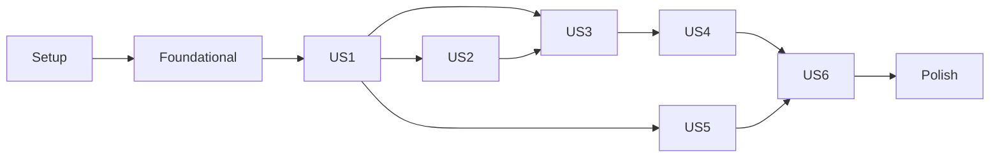

---

description: "Task list for Castelo do Eco (versão web)"
---

# Tasks: Castelo do Eco (versão web)

**Input**: Design documents from `/specs/002-castelo-do-eco-web/`

**Prerequisites**: [plan.md](plan.md), [spec.md](spec.md), [research.md](research.md), [data-model.md](data-model.md), [contracts/](contracts/), [quickstart.md](quickstart.md)

**Tests**: OBRIGATÓRIOS. A constituição (Princípio III, Test-First NON-NEGOTIABLE) exige testes escritos e vistos falhando antes da implementação. Testes `node:test` rodam com `npm test`; testes de navegador (Playwright) rodam com `npm run test:e2e`.

**Organization**: tarefas agrupadas por história de usuário, para que cada uma seja implementada e testada de forma independente.

## Format: `[ID] [P?] [Story] Description`

- **[P]**: pode rodar em paralelo (arquivos diferentes, sem dependências pendentes)
- **[Story]**: história de usuário à qual a tarefa pertence (US1 a US6)

## Path Conventions

Web em `web/`, núcleo existente em `src/core/`, ferramentas em `scripts/`, testes em `tests/unit/web/` e `tests/e2e/` (ver [plan.md](plan.md)).

---

## Phase 1: Setup (Shared Infrastructure)

**Purpose**: dependências de desenvolvimento, scripts e estrutura

- [X] T001 Instalar as dependências de desenvolvimento `fake-indexeddb` e `@playwright/test` e acrescentar os scripts `"web": "node scripts/serve-web.js"` e `"test:e2e": "playwright test"` em package.json, mantendo `"test"` restrito a `tests/**/*.test.js` fora de `tests/e2e/` (ex.: `node --test "tests/{unit,integration,acceptance}/**/*.test.js"`), em package.json
- [X] T002 Criar a estrutura de pastas do plano: `web/js`, `web/docs`, `web/img`, `scripts`, `tests/unit/web`, `tests/e2e`, em web/
- [X] T003 [P] Configurar o Playwright com projeto Chromium, `testDir: 'tests/e2e'` e `webServer` iniciando `node scripts/serve-web.js` com `ECO_WEB_PORT=8181`, `baseURL: 'http://127.0.0.1:8181/web/'`, em playwright.config.js
- [X] T004 [P] Acrescentar ao ESLint um bloco para `web/**/*.js` com globais de navegador (`window`, `document`, `self`, `indexedDB`, `crypto`, `navigator`, `location`, `URLSearchParams`, `BroadcastChannel`, `Worker`, `TextEncoder`, `sessionStorage`, `caches`, `fetch`) e a regra `no-restricted-properties` proibindo `innerHTML`, `outerHTML` e `insertAdjacentHTML`, em eslint.config.js
- [X] T005 [P] Acrescentar `test-results/` e `playwright-report/` ao .gitignore, em .gitignore

---

## Phase 2: Foundational (Blocking Prerequisites)

**Purpose**: núcleo portável, servidor local, textos, log e esqueleto das páginas

**⚠️ CRITICAL**: nenhuma história pode começar antes desta fase terminar

- [X] T006 Escrever teste que falha se algum arquivo de `src/core/` ou `src/cli/messages.pt-br.js` usar `Buffer`, `process` ou importar módulos `node:`, e manter os casos de `ENTRADA_MUITO_GRANDE` existentes, em tests/unit/web/nucleo-portavel.test.js
- [X] T007 Trocar `Buffer.byteLength(texto, 'utf8')` por contagem UTF-8 portável: se `texto.length * 3 <= LIMITE_BYTES` aceitar sem codificar; caso contrário usar `new TextEncoder().encode(texto).length`; os 108 testes existentes devem continuar passando, em src/core/parse-input.js
- [X] T008 [P] Escrever testes do servidor local: serve `web/index.html`, `src/core/predict.js` e `src/cli/messages.pt-br.js` com MIME correto (`text/html`, `text/javascript`, `text/css`, `image/svg+xml`); responde 404 para `/dados/memorias.json`, `/package.json`, `/src/cli/app.js` e caminhos com `..` ou codificados (`%2e%2e`); só escuta em `127.0.0.1`; envia `Service-Worker-Allowed: /` para `web/sw.js`, em tests/unit/web/serve-web.test.js
- [X] T009 Implementar o servidor estático com `node:http`, porta `ECO_WEB_PORT` (padrão 8080), host fixo `127.0.0.1`, lista permitida `web/`, `src/core/`, `src/cli/messages.pt-br.js`, resolução de caminho com `path.resolve` e verificação de prefixo, exportando `iniciarServidor({ porta })` para os testes e mostrando a URL no terminal, em scripts/serve-web.js
- [X] T010 [P] Criar os textos da web reexportando `mensagens` e `nomeDoPadrao` de `../../src/cli/messages.pt-br.js` e acrescentando rótulos de botões, títulos de telas, "Ouvindo…", avisos de armazenamento, de redução de pontos e de valores fora de escala, todos em português do Brasil, em web/js/textos.js
- [X] T011 [P] Escrever testes do log técnico com `fake-indexeddb`: grava `ts`, `nivel` (`info`, `aviso`, `erro`), `evento` e `codigo` opcional; descarta outros campos; mantém "No máximo 500 registros", removendo os mais antigos; falha do IndexedDB não lança erro, em tests/unit/web/log.test.js
- [X] T012 Implementar a abertura do banco `castelo-do-eco` versão 1 criando os stores `ecos` (keyPath `id`, índices `aluno` e `criadoEm`), `config` (keyPath `chave`) e `logs` (autoincremento), com aviso quando a versão existente for maior que a conhecida, em web/js/banco.js
- [X] T013 Implementar o log técnico sobre `banco.js` conforme T011, em web/js/log.js
- [X] T014 Criar o esqueleto de `index.html` com `<html lang="pt-BR">`, Content-Security-Policy em `<meta>` (`default-src 'self'; script-src 'self'; style-src 'self'; img-src 'self' data:; worker-src 'self'; object-src 'none'; base-uri 'none'; form-action 'none'`), `<script type="module" src="js/main.js">` e regiões vazias para nome, sequência, resposta, gráfico, histórico e avisos, em web/index.html
- [X] T015 [P] Criar a folha de estilo base (layout, tipografia legível, foco visível, classes de estado) que o tema da US6 vai completar, em web/estilo.css
- [X] T016 [P] Criar o utilitário de testes e2e com um `fixture` que limpa o IndexedDB e o `sessionStorage` antes de cada teste e uma função `entrarComNome(page, nome)`, em tests/e2e/ajudantes.js

**Checkpoint**: base pronta; as histórias podem começar

---

## Phase 3: User Story 1 - Aluno descobre o próximo número no Castelo do Eco (Priority: P1) 🎯 MVP

**Goal**: o aluno informa nome e sequência no navegador e recebe o mesmo resultado da Sala do Eco.

**Independent Test**: cenários 1 a 6 e 8 do [quickstart.md](quickstart.md) e `npm test -- tests/unit/web/calcular-eco.test.js`.

### Tests for User Story 1 ⚠️

- [X] T017 [P] [US1] Escrever teste de equivalência web × console: para todos os exemplos oficiais (`3, 6, 9, 12`→`15`, `1, 4, 9, 16`→`25`, `2, 4, 8`→`16`, `2, 4`→`6`, `1, 1, 2, 3, 5`→`8`, `1,5; 3; 4,5`→`6`, `5`→erro, `10, 20, 30, abc`→erro item 4) e `3, 1, 4, 1, 5`→sem padrão, `calcularEco(texto)` devolve o mesmo `status`, `padrao`, `proximo` e o mesmo texto de mensagem gerado por `src/cli/messages.pt-br.js`, em tests/unit/web/calcular-eco.test.js
- [X] T018 [P] [US1] Escrever testes de navegador: nome `Ana` e `3, 6, 9, 12` mostra `O eco responde: 15` e `Padrão: progressão aritmética`; `10, 20, 30, abc` mostra a mensagem do item 4 e o campo mantém o texto; `3, 1, 4, 1, 5` mostra sem padrão; nome `<b>x</b>` aparece literalmente e `<script>alert(1)</script>` é rejeitado sem diálogo; `index.html?seq=2,4,8` envia automaticamente após o nome e mostra `16`; o nome deve ter "1 a 40 caracteres", em tests/e2e/eco.spec.js

### Implementation for User Story 1

- [X] T019 [US1] Implementar `calcularEco(texto)` puro: chama `parseInput` e `predict` de `../../src/core/` e devolve `{ status, padrao, grau, proximo, erro, detalhe, quantidade, mensagem }`, com `mensagem` montada pelos textos compartilhados, em web/js/calcular-eco.js
- [X] T020 [US1] Implementar o Web Worker de módulo que recebe `{ id, texto }`, chama `calcularEco` e responde `{ id, resultado }` ou `{ id, falha: true }` sem expor detalhes do erro, em web/js/eco-worker.js
- [X] T021 [US1] Implementar a tela principal: pedir o nome (1 a 40 caracteres, sem caracteres de controle, guardado em `sessionStorage`), enviar a sequência ao Worker com Enter ou botão, mostrar "Ouvindo…" e desabilitar o botão enquanto calcula, exibir resposta, padrão e link "Saiba mais" para `docs/<padrao>.html`, manter o texto do campo em caso de erro, tratar `?seq=` com `URLSearchParams`, usar apenas `textContent` e `createElement`, em web/js/main.js
- [X] T022 [US1] Completar a marcação da tela principal com rótulos acessíveis (`<label for>`), região de resposta com `aria-live="polite"` e links para documentação e área do professor, em web/index.html

**Checkpoint**: US1 funcional; o MVP pode ser demonstrado no navegador

---

## Phase 4: User Story 2 - Aluno vê o gráfico da sequência (Priority: P1)

**Goal**: cada eco válido desenha o gráfico da sequência com a previsão destacada, sem travar a página.

**Independent Test**: cenários 1, 2, 6, 7 e 17 do [quickstart.md](quickstart.md) e `npm test -- tests/unit/web/grafico-dados.test.js`.

### Tests for User Story 2 ⚠️

- [X] T023 [P] [US2] Escrever testes de `prepararGrafico({ valores, casas }, proximo)`: `1, 4, 9, 16` gera 4 pontos com índices 1 a 4 e previsão `{ indice: 5, valor: 25, rotulo: '25' }`; previsão `8/3` gera `valor ≈ 2.6667` e `rotulo: '8/3'`; sem previsão não há `previsao`; 1.000.000 de valores geram no máximo 1.000 pontos, `reduzido: true`, mantendo o primeiro e o último; valores acima de ±1e300 geram `foraDeEscala: true`; `minimo` e `maximo` incluem a previsão; sequência constante gera escala não degenerada, em tests/unit/web/grafico-dados.test.js
- [X] T024 [P] [US2] Escrever testes de navegador: após `1, 4, 9, 16` o SVG tem 4 marcadores comuns e 1 marcador de previsão com rótulo `25`, `role="img"` e `<title>`; após `3, 1, 4, 1, 5` não há marcador de previsão; após `abc, 1, 2` nenhum SVG novo é desenhado; uma sequência de 1.000.000 de números mostra "Ouvindo…", a página continua respondendo a cliques e a resposta `1000001` aparece em até 5 s com aviso de redução, em tests/e2e/grafico.spec.js

### Implementation for User Story 2

- [X] T025 [US2] Implementar `prepararGrafico` puro: conversão para `Number` só para desenho (`Number(v) / 10 ** casas`), redução por faixas guardando mínimo e máximo de cada faixa até "no máximo 1.000 itens", sempre com primeiro, último e previsão, `foraDeEscala` acima de ±1e300, conversão do rótulo exato (`8/3`, `-0.5`) para posição, em web/js/grafico-dados.js
- [X] T026 [US2] Incluir os pontos do gráfico no resultado do Worker, calculados dentro dele para que nenhum `BigInt` seja copiado para a página, em web/js/calcular-eco.js
- [X] T027 [US2] Implementar o desenho do SVG com `createElementNS`: eixos, linha ligando os pontos, marcador da previsão com forma e cor diferentes e rótulo exato, `role="img"`, `<title>` em português descrevendo a sequência, avisos de redução e de valores fora de escala, em web/js/grafico-svg.js
- [X] T028 [US2] Desenhar o gráfico após cada eco válido e não desenhar em caso de erro, em web/js/main.js

**Checkpoint**: US1 e US2 funcionam de forma independente

---

## Phase 5: User Story 3 - Histórico de ecos no navegador (Priority: P2)

**Goal**: memórias persistentes no navegador, consultáveis e reabríveis.

**Independent Test**: cenários 9 e 10 do [quickstart.md](quickstart.md) e `npm test -- tests/unit/web/memorias.test.js`.

### Tests for User Story 3 ⚠️

- [X] T029 [P] [US3] Escrever testes do repositório de memórias com `fake-indexeddb`: `registrar` grava os campos de [data-model.md](data-model.md) (`id` UUID, `aluno`, `criadoEm` ISO UTC, `entrada` "cortada em 4.096 caracteres" com `truncado`, `quantidade`, `status` em `ok`/`sem_padrao`/`invalido`, `padrao` e `grau` só se `ok`, `proximo` só se `ok`, `erro` só se `invalido`, `versaoEsquema: 1`); `listarPorAluno` e `listarTodos` do mais recente para o mais antigo; registros malformados são ignorados e contados em `danificados`; falha da transação lança erro com `code`, em tests/unit/web/memorias.test.js
- [X] T030 [P] [US3] Escrever testes de navegador: dois ecos, recarregar a página, o histórico mostra os dois do mais recente ao mais antigo com data e hora; clicar num eco reabre resposta e gráfico; ecos inválidos e sem padrão aparecem identificados; com duas abas, um eco em cada aparece no histórico de ambas; entrada vazia não gera eco, em tests/e2e/historico.spec.js

### Implementation for User Story 3

- [X] T031 [US3] Implementar o repositório de memórias sobre `banco.js` (`registrar`, `listarPorAluno`, `listarTodos`, `apagarTudo`, cada um numa transação), validação de registros na leitura e publicação de `eco_registrado` numa `BroadcastChannel('castelo-do-eco')`, em web/js/memorias.js
- [X] T032 [US3] Gravar cada eco antes de exibir a resposta (exceto entrada vazia), mostrar o aviso "não consegui guardar esta memória" quando a gravação falhar e registrar `memoria_nao_salva` no log, em web/js/main.js
- [X] T033 [US3] Implementar a lista do histórico do aluno (data e hora, entrada com até 60 caracteres, resultado ou rótulo de erro), reabrir resposta e gráfico a partir de `entrada` (com aviso se `truncado`), atualizar ao receber mensagens da `BroadcastChannel`, aviso de memórias danificadas e chamada a `navigator.storage.persist()` na abertura, em web/js/main.js

**Checkpoint**: memórias persistem entre aberturas e abas

---

## Phase 6: User Story 4 - Professor vê o que os alunos digitaram (Priority: P2)

**Goal**: área protegida por PIN para professor e administrador, restrita aos ecos daquele navegador.

**Independent Test**: cenários 13 a 16 do [quickstart.md](quickstart.md) e `npm test -- tests/unit/web/pins.test.js`.

### Tests for User Story 4 ⚠️

- [X] T034 [P] [US4] Escrever testes dos PINs com `fake-indexeddb` e a Web Crypto do Node: aceita só "4 a 8 dígitos"; grava `{ chave, sal, hash, iteracoes: 600000 }` com sal de 16 bytes e hash de 32 bytes em base64; o PIN nunca aparece no registro; verifica PIN correto e recusa errado; PINs de professor e administrador independentes; dois PINs iguais geram hashes diferentes, em tests/unit/web/pins.test.js
- [X] T035 [P] [US4] Escrever testes de navegador: com ecos de `Ana` e `Bruno`, o professor define o PIN e vê os ecos agrupados por aluno com o aviso de que só aparecem ecos deste navegador; 3 PINs errados negam acesso sem mostrar dados; o administrador com resposta `nao` não apaga nada; com `APAGAR` o histórico fica vazio; o PIN nunca aparece no texto da página nem na URL; o PIN do professor não abre a área do administrador, em tests/e2e/professor.spec.js

### Implementation for User Story 4

- [X] T036 [P] [US4] Implementar os PINs com `crypto.subtle` (PBKDF2-SHA-256, 600.000 iterações, sal de 16 bytes, 32 bytes de saída), comparação em tempo constante, `temPin`, `definirPin`, `verificarPin` e validação "4 a 8 dígitos", em web/js/pins.js
- [X] T037 [US4] Criar a página do professor com a mesma CSP e estrutura de `index.html`, campos `type="password"`, `inputmode="numeric"`, `autocomplete="off"`, áreas do professor e do administrador e link de volta ao Castelo, em web/professor.html
- [X] T038 [US4] Implementar o fluxo: primeiro acesso (definir e confirmar PIN), 3 tentativas com atraso crescente de 0,5 s e 1 s, lista agrupada por aluno (`Nome (N ecos)`) com aviso de navegador local, apagar só com `APAGAR` e registro `memorias_apagadas` no log, sem nunca escrever o PIN no log, na tela ou na URL, em web/js/professor.js

**Checkpoint**: professor e administrador funcionam no navegador

---

## Phase 7: User Story 5 - Site de documentação dos conceitos matemáticos (Priority: P3)

**Goal**: sete páginas com definições e exemplos executáveis, sempre coerentes com o núcleo.

**Independent Test**: cenários 11 e 12 do [quickstart.md](quickstart.md) e `npm test -- tests/unit/web/exemplos-docs.test.js`.

### Tests for User Story 5 ⚠️

- [X] T039 [P] [US5] Escrever teste que importa `web/docs/exemplos.js` e confere, para cada `{ padrao, entrada, esperado }`, que `predict(parseInput(entrada))` devolve o mesmo `padrao` e `proximo === esperado`, e que cada um dos cinco padrões tem pelo menos 2 exemplos, em tests/unit/web/exemplos-docs.test.js
- [X] T040 [P] [US5] Escrever testes de navegador: `docs/index.html` lista os cinco padrões e a página de precedência; em cada página de padrão, clicar em cada exemplo abre o Castelo do Eco e mostra o resultado indicado; "Saiba mais" após `2, 4, 8` abre `docs/geometrica.html`, em tests/e2e/docs.spec.js

### Implementation for User Story 5

- [X] T041 [P] [US5] Criar os dados dos exemplos (pelo menos 2 por padrão, incluindo `2, 4, 8`→`16`, `9, 6, 4`→`8/3`, `1, 4, 9, 16`→`25`, `1, 8, 27, 64, 125`→`216`, `1, 1, 2, 3, 5`→`8`, `-3, 0, 3`→`6`, `7, 7, 7`→`7`), em web/docs/exemplos.js
- [X] T042 [US5] Implementar a renderização dos exemplos da página atual (padrão lido de `data-padrao` no `<body>`) como links para `../index.html?seq=<entrada codificada>` com o resultado esperado, usando só `textContent`, em web/docs/docs.js
- [X] T043 [P] [US5] Escrever as páginas de documentação com a mesma CSP, `lang="pt-BR"` e navegação entre elas: `index.html`, `precedencia.html` (ordem constante → aritmética → geométrica → Fibonacci → polinomial, mínimos por padrão, regra de 2 números), `constante.html`, `aritmetica.html`, `geometrica.html`, `fibonacci.html`, `polinomial.html` (diferenças sucessivas, graus de 2 a 5), em web/docs/

**Checkpoint**: documentação navegável e testada

---

## Phase 8: User Story 6 - Interface temática do Castelo do Eco (Priority: P3)

**Goal**: identidade visual de castelo coerente em todas as telas, sem prejudicar a leitura.

**Independent Test**: percorrer todas as páginas e conferir tema, legibilidade e textos em português.

### Tests for User Story 6 ⚠️

- [X] T044 [P] [US6] Escrever testes de navegador que visitam `index.html`, `professor.html` e as sete páginas de `docs/` e verificam: `lang="pt-BR"`, a folha `estilo.css` aplicada, o cabeçalho temático com o nome "Castelo do Eco", ausência de erros no console e contraste mínimo de 4,5:1 entre o texto principal e o fundo (cálculo pelas cores computadas), em tests/e2e/tema.spec.js

### Implementation for User Story 6

- [X] T045 [P] [US6] Criar ilustrações SVG próprias do castelo (cabeçalho e ícone do eco), sem copiar produtos existentes, em web/img/
- [X] T046 [US6] Completar o tema: paleta de castelo com contraste mínimo de 4,5:1, cabeçalho com ilustração, estilo dos cartões de resposta, histórico, gráfico e áreas de PIN, foco visível e layout que não quebra em telas estreitas, em web/estilo.css
- [X] T047 [US6] Aplicar o cabeçalho temático e os textos no tom de "eco mágico" em todas as páginas, em web/index.html

**Checkpoint**: todas as histórias funcionam de forma independente

---

## Phase 9: Polish & Cross-Cutting Concerns

- [X] T048 Escrever teste de navegador que carrega a página, entra em modo offline, recarrega e verifica que o eco, o gráfico e a documentação continuam funcionando, em tests/e2e/offline.spec.js
- [X] T049 Implementar o service worker com cache versionado da lista fixa de arquivos (`web/`, `src/core/`, `src/cli/messages.pt-br.js`, documentação e imagens), resposta do cache primeiro e remoção dos caches antigos, e registrá-lo em `main.js`, em web/sw.js
- [X] T050 [P] Atualizar o README com a seção "Castelo do Eco": `npm run web`, endereço fixo e por que a porta importa, histórico preso ao navegador, aviso sobre limpar dados do navegador, definir os PINs na instalação, testes `npm run test:e2e`, em README.md
- [X] T051 Rodar `npm test`, `npm run test:e2e`, `npm run lint` e `npm audit`; confirmar que os testes da Fase 1 continuam passando e corrigir o que falhar, em package.json
- [X] T052 Executar manualmente os 19 cenários do quickstart (ou os que o Playwright não cobrir, se o navegador não puder ser baixado) e corrigir divergências, em specs/002-castelo-do-eco-web/quickstart.md

---

## Dependencies & Execution Order

### Phase Dependencies

- **Setup (Phase 1)**: sem dependências
- **Foundational (Phase 2)**: depende do Setup e bloqueia todas as histórias
- **US1 (Phase 3)**: depende da Phase 2
- **US2 (Phase 4)**: depende de US1 (estende `calcular-eco.js` e a tela principal)
- **US3 (Phase 5)**: depende de US1; reabrir o gráfico usa US2
- **US4 (Phase 6)**: depende da Phase 2 e do repositório de memórias da US3 (`memorias.js`)
- **US5 (Phase 7)**: depende de US1 (links `?seq=` e "Saiba mais"); o teste T039 só depende do núcleo
- **US6 (Phase 8)**: depende das páginas criadas nas US1, US4 e US5
- **Polish (Phase 9)**: depende de todas as histórias desejadas



### Within Each User Story

- Testes primeiro, falhando
- Módulos puros antes do Worker; Worker antes da tela
- Repositório antes das telas que o usam

## Parallel Example: User Story 1

```text
T017 tests/unit/web/calcular-eco.test.js
T018 tests/e2e/eco.spec.js
```

## Parallel Example: User Story 4

```text
T034 tests/unit/web/pins.test.js | T035 tests/e2e/professor.spec.js
T036 web/js/pins.js (em paralelo com a escrita dos testes de navegador)
```

## Parallel Example: User Story 5

```text
T039 exemplos-docs.test.js | T040 docs.spec.js | T041 exemplos.js | T043 páginas HTML
```

## Implementation Strategy

### MVP First (User Story 1)

1. Phase 1 e Phase 2
2. Phase 3 (US1)
3. **Parar e validar**: exemplos oficiais iguais à Sala do Eco, cenários 1 a 6 e 8
4. Demonstrar à diretoria

### Incremental Delivery

1. MVP (US1)
2. US2: gráfico (completa as histórias P1)
3. US3 e US4: histórico e professor (P2)
4. US5 e US6: documentação e tema (P3)
5. Polish: uso offline e documentação

## Notes

- [P] = arquivos diferentes, sem dependências pendentes
- Várias tarefas editam `web/js/main.js`; elas são sequenciais
- Confirmar que os testes falham antes de implementar (Princípio III)
- Requisitos "Em análise" (RF-08, RF-11, RF-12, RF-16, RNF-10, RNF-12, RNF-14) e gráficos agregados do histórico estão fora do escopo
- Se o navegador do Playwright não puder ser baixado, registrar isso e validar pelo quickstart manual (T052)
